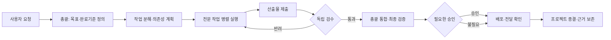

# AI 에이전트 오케스트레이션 구조

> 상태: 2026-10-22 기준 설계 계약. **현재 동작**과 **목표 상태**를 구분한다. 이 문서는 특정 팀 이름이나 컴퓨터 경로를 범용 규격에 넣지 않는다.

## 목적과 원칙

한 명의 총괄(coordinator)이 사용자의 목표와 최종 책임을 맡고, 전문 에이전트가 범위가 분명한 작업을 수행한다. 전문 작업의 완료 주장은 검수 통과가 아니며, 검수 통과도 사용자에게 전달된 결과의 통합 완료가 아니다.

- 요청을 프로젝트와 원본 메시지에 연결한다. 모호한 프로젝트는 미분류로 남긴다.
- 한 작업에는 한 책임자와 확인 가능한 완료 기준을 둔다.
- 선행 작업이 필요한 후속 작업은 선행 산출물의 검수 전에는 실행하지 않는다.
- 외부 발송·구매·게시·배포는 실제 부작용의 중복 여부와 승인 경계를 확인한다.
- 화면은 기록된 사실만 그린다. 역할이나 작업 제목으로 의존성·QA 합격을 추측하지 않는다.

## 실행 흐름

### 범용 데이터 계약

| 개체 | 최소 필드 | 불변식 |
| --- | --- | --- |
| Run | runId, projectId, sourceRef, goal, acceptanceCriteria, coordinatorAgentId, state | sourceRef는 재수집 시 멱등키가 된다 |
| Agent | agentId, capabilities, capacity, runnerRef | 표시명·경로와 안정적 ID를 분리한다 |
| Task | taskId, runId, ownerAgentId, objective, dependsOn, acceptanceCriteria, artifactRefs, state | hard 선행 조건이 충족되기 전 dispatch 금지 |
| Review | taskId, reviewerAgentId, artifactVersion, criteriaResults, decision, evidenceRefs | 제출자와 검수자를 분리한다 |
| Integration | inputArtifactVersions, checks, decision, deliveryReceipt | 필요한 검수·승인 없이는 완료 금지 |
| Event | eventId, entityId, actorId, type, expectedVersion, idempotencyKey, occurredAt | 변경·알림·재시도의 근거를 남긴다 |

작업 단계: `planned → ready → assigned → working → submitted → reviewing → accepted → integrating → integrated`. 반려는 `changes_requested → working`으로 돌린다. `blocked`에는 원인, 소유자, 재개 조건을 기록한다. 기존 `done` 기록은 검수 증거가 없으면 `legacy_done_unverified`로만 표시한다.

### 역할과 책임

| 역할 | 책임 | 완료 증거 |
| --- | --- | --- |
| 총괄 | 목표·수락기준, 작업 분해, 충돌 해결, 통합, 대외 보고 | 통합 검증·전달 영수증 |
| 전문 담당 | 범위 내 실행과 결과 제출 | 산출물 버전·검증 방법·남은 위험 |
| 독립 검수 | 기준별 합격/반려 판정 | 재현 가능한 근거와 판정 |
| 사용자 | 가격·권한·외부 공개 등 사용자 소유 결정 | 필요한 승인 기록 |

에이전트 배정은 역할 적합성·현재 부하뿐 아니라 권한과 실제 가용성도 확인한다. 특정 이름/이모지에 업무유형을 고정하지 않는다.

## 현재 구현과 단계적 도입

현재 프로젝트 허브는 사용자 요청을 프로젝트 이벤트로 분류하고, 작업방은 작업 생성 뒤 규칙 기반 자동 배정·상태 변경·알림을 제공한다. 그러나 프로젝트 이벤트가 자동으로 전문 작업 DAG를 만드는 것은 아니며, 작업 카드와 OpenClaw 실제 실행 ID가 연결되지 않는다. 저장된 상태는 주로 일정/확정/진행/완료이고 검수·통합 게이트와 산출물 버전은 아직 권위 있는 데이터 모델이 아니다.

OpenClaw의 임시·중첩 서브에이전트도 현재 작업 카드에 자동으로 연결되지 않는다. 상시 팀 에이전트와 임시 실행을 분리하는 목표 계약, 접수증과 완료 증거의 구분, 부모-자식 세션 추적·실패 복구는 [서브에이전트 실행 설계](subagent-runtime.md)에 정리했다. 이 문서는 목표 설계이며 현재 대시보드에 실행 추적이 배포됐다는 뜻은 아니다.

1. **관찰 가능성**: 프로젝트 연결 작업을 업무현황에 읽기 전용 흐름으로 보여준다. 없는 의존성/검수 근거는 ‘미기록’. 기존 칸반·데이터는 그대로 둔다.
2. **운영 절차**: 총괄이 재사용 스킬에 따라 복합 요청을 분해·배정·검수·통합하고, 작업방/프로젝트 허브에 증거를 기록한다. 후속 작업은 선행 검수 전 수동 보류한다.
3. **실행 제어**: 명시적 `runId`, `dependsOn`, `artifactVersion`, `reviewDecision`, `executionRef`를 도입하고 서버에서 전이·권한·DAG를 검증한다. 기존 `PATCH status` 우회 경로는 호환 기간 뒤 제한한다.
4. **내구성**: transactional event/outbox, 실행 lease, 재시도·재조정·전달 영수증을 추가한다. 원장을 하나만 둔다. 별도 control plane을 채택하면 기존 작업방과 양방향으로 권위가 충돌하지 않도록 이관한다.

## 실패·복구 규칙

- 에이전트가 확인/시작하지 않으면 지정 시간 뒤 총괄에게 알리고, 실제 실행 여부를 확인한 후 재배정한다.
- 선행 산출물이 수정되면 이를 소비한 후속 검수·통합을 stale로 표시하고 재검증한다.
- 발송/게시/구매가 불확실하면 외부 상태와 영수증부터 조회한다. 확인 전 자동 재실행하지 않는다.
- 알림 실패는 작업 성공을 취소하지 않는다. 전송 상태를 별도로 추적한다.
- 막힌 작업은 “원인·담당자·재개 조건”이 없는 채로 완료 처리하지 않는다.

## 수업용 데모

가상의 신제품 상세페이지를 사용한다. 조사 A가 검수 통과한 뒤 글 B와 디자인 C가 병렬 진행되고, 둘 다 통과해야 조립 D를 시작한다. 독립 QA E가 가격 근거 오류를 발견하면 B를 반려하고 D/E의 기존 검증은 stale로 표시한다. 수정·재검증·총괄 통합 후 사용자 승인을 받아 공개한다. 실계정·고객정보·토큰을 데모 데이터로 쓰지 않는다.

## 수용 기준

- 동일 요청 재수집으로 작업이 중복 생성되지 않는다.
- 선행 검수 전 하류 작업이 실행되지 않는다.
- 담당자의 `done` 발언만으로 QA/통합이 통과로 표시되지 않는다.
- 차단 상태에는 원인·소유자·재개 조건이 보인다.
- 대시보드는 실제 작업·프로젝트 원장과 일치하며 320px 모바일·키보드에서도 주요 상태를 읽을 수 있다.
- 배포/발송이 있으면 실제 전달을 확인한 뒤에만 최종 완료로 보고한다.
